# 开源版锤子便签


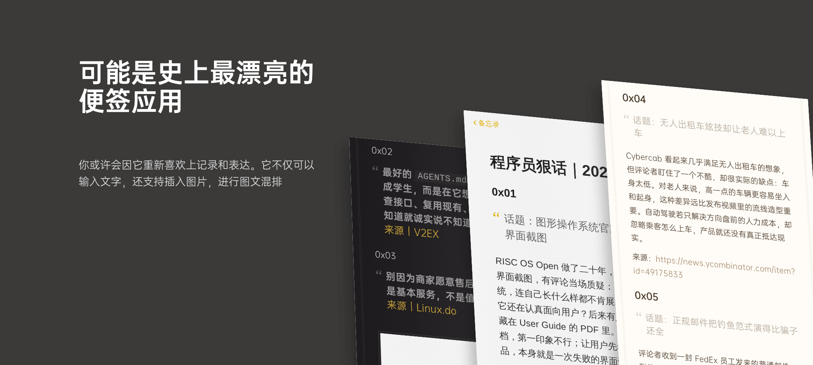


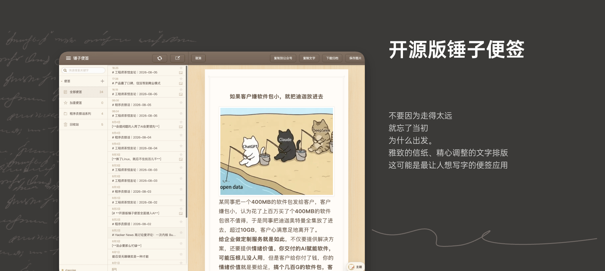

| 支持手机版 | 一键发送公众号 |
| --- | --- |
| 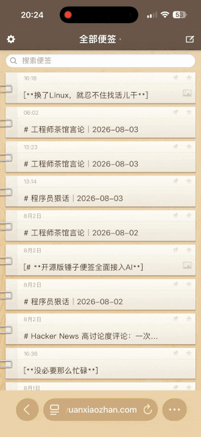 | 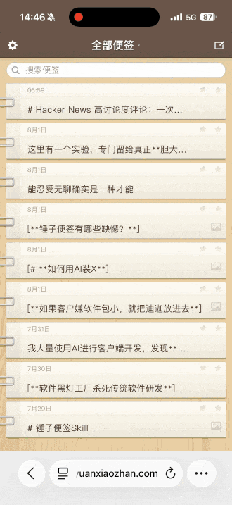 |


- 一个锤子便签风格的导出器，预览与图片导出支持**暖白纸感**、**深夜便签**、**iPhone 备忘录深浅模式**和 **Bear 极简排版**。
- 可用来分享与openclaw的对话记录。
- 完美复刻锤子便签网页版和PC版，支持多便签，分类存储。
- 支持 Cloudflare Workers 免费部署（D1 + R2，无需服务器）
- 纯WEB应用，无需安装任何App，打开即用
- 支持PC端和手机版，多端数据同步，支持公网部署
- 支持图片插入。
- 支持一键粘贴到公众号助手。
- 支持直接导出便签为图片，或复制为markdown格式进行分享。
- 自带浏览器持久化，关闭页面也不会丢失数据。
- 开源免费，可私有化部署。
- 工匠精神沁入AI，可以通过AI Skill直接调用工具，生成便签。
- 支持自定义底部标识（点击即可编辑）
- API原生封装支持Hermes Agent，OpenClaw直接通过skill驱动管理便签
- 支持 DeepSeek Harness（DSH），让智能体将对话导出为锤子便签。
- 支持接入DeepSeek润色书写内容，语法标点检查，重点加粗，复杂概念通俗化释义。
- 支持一键下载包含图片的Markdown资源包
- 支持下载为html离线查看

## 通过DSH调用

可以在 DSH 的“插件市场”中搜索 `notes` 直接安装；源码仓库已经携带预编译产物，
无需开启 `allowBuilds`。也可以通过命令行安装 npm 版本：

```
dsh plugin --profile web add @zhaoolee/dsh-notes
```

安装后请重启目标 profile，使插件生效。重启后，在 DeepSeek Harness 对话中说：**把我们的对话导出成便签**， 智能体会自动整理当前对话并调用插件生成便签。

| Deepseek Harness 生成分享便签 | 导出效果 |
| --- | --- |
| 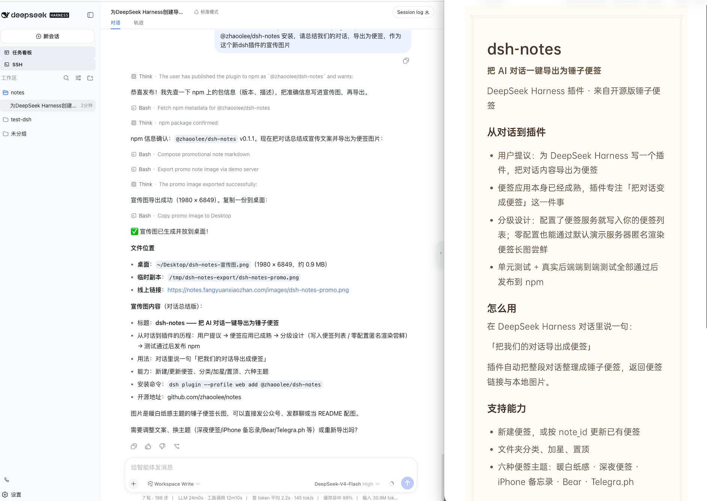 | 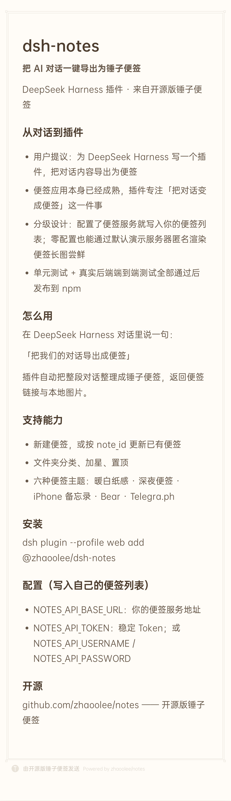 |


## 通过skill调用

clawhub地址 https://clawhub.ai/zhaoolee/notes-export-api

```
从clawhub安装 notes-export-api这个 skill,
联网获取最近一周 AI 相关的新闻，将新闻转化为 markdown 生成便签图片，把便签图片绝对路径返回给我，把图片往“下载”文件夹复制一份
```

## 支持自定义底部品牌标识(点击就能改)

只要你喜欢，可以把底部的「锤子便签」改成「凿子便签」或「榔头便签」


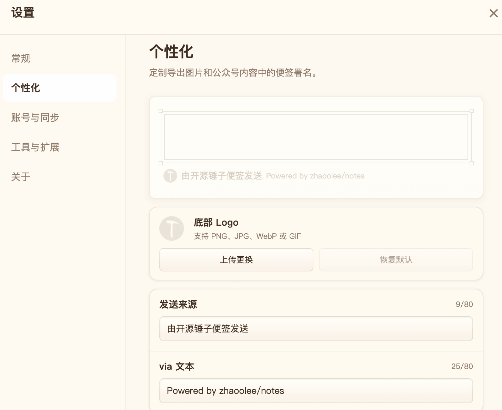


## 支持下载文章，包含网页，markdown以及管理的图片资源


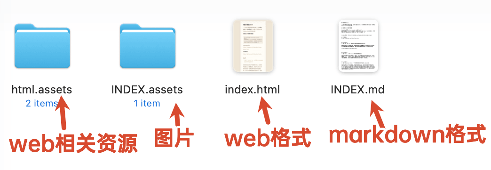

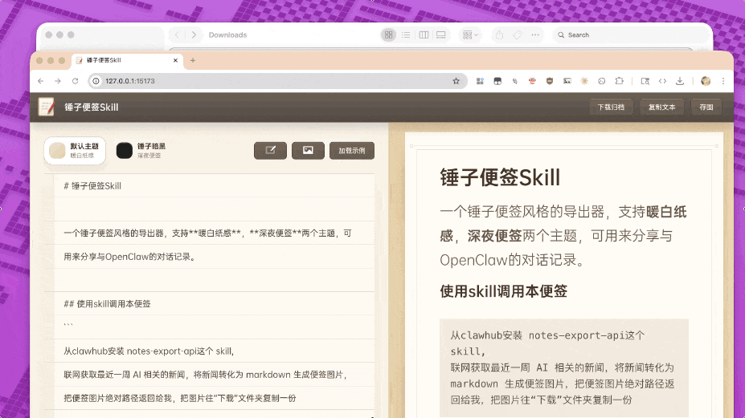

## 支持接入DeepSeek，修正语法错误，重点加粗，通俗化润色

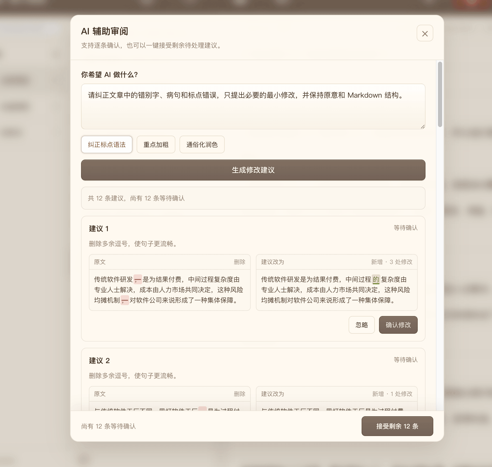

## 零配置，复制即可将权限导入hermes agent

登陆后，复制一行专属链接，粘贴给Hermes Agent或OpenClaw，即可获取包含登身份认证的skill包，实现人机协同

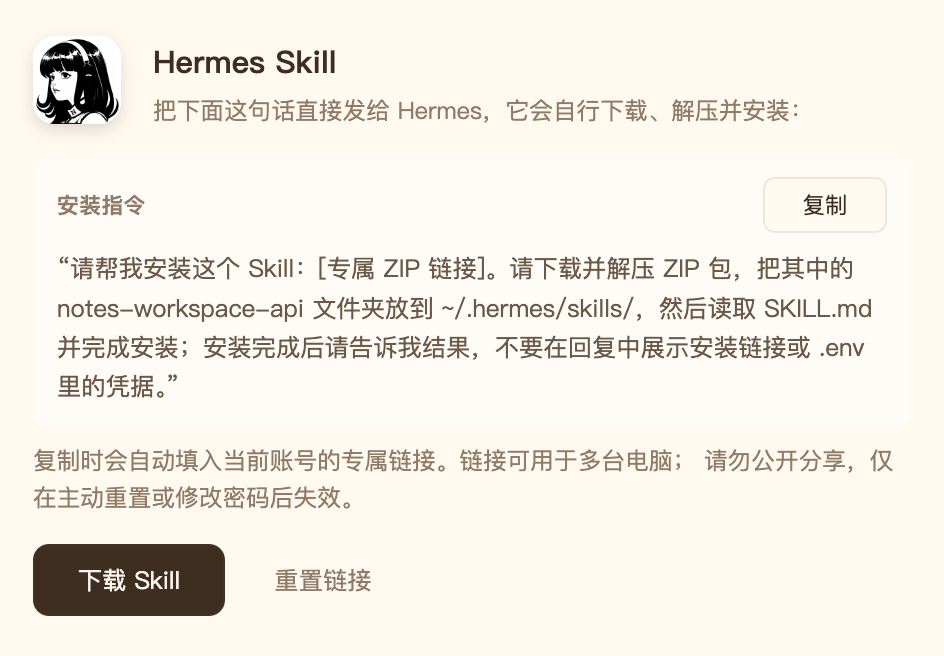

## 支持多用户隔离

可以给AI分配一个账号，人类分配一个账号，数据严格隔离

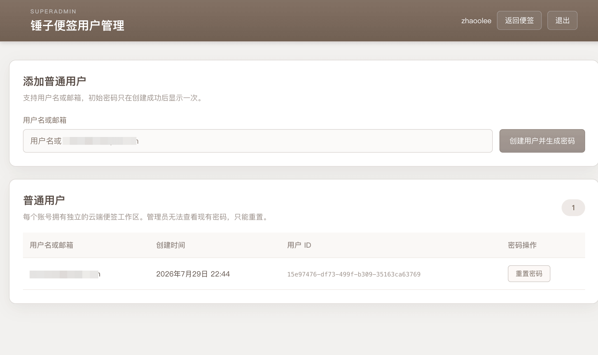


## 支持一键粘贴到公众号助手

在手机的网页写完，直接一键粘贴到公众号即可发送，文本格式和图片，统统自动处理好！

## 支持子公司和各类知名主题

| 子公司主题  | 母公司主题 |
| --- | --- |
| 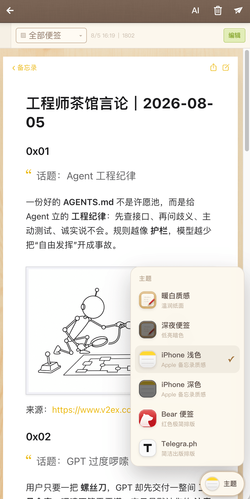 | 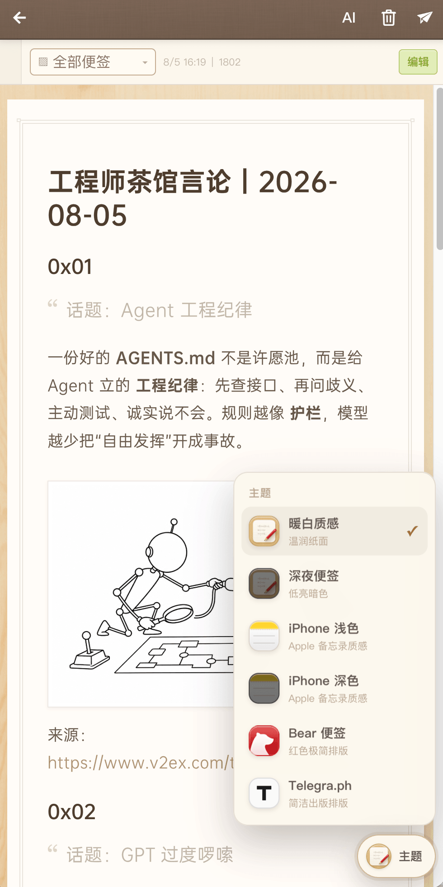 |


## 网页版


| 暖白纸感 | 深夜便签 |
| --- | --- |
| 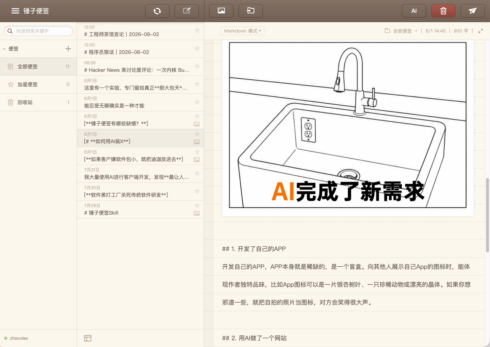 | 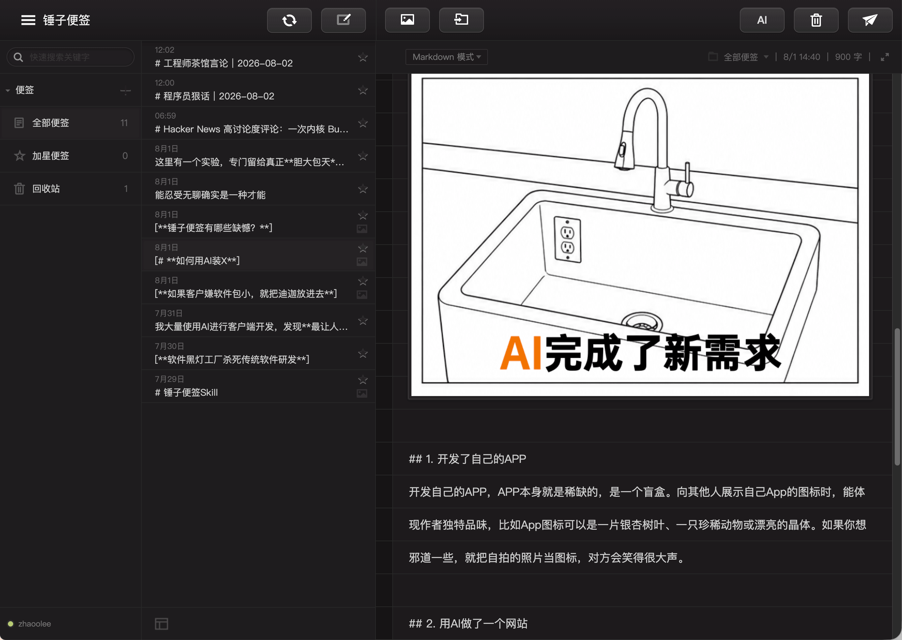 |
|  |  |


## Skill 服务地址

便签管理和 PNG 导出统一使用 `NOTES_API_BASE_URL`，可写入
`skills/notes-export-api/.env`，或通过 `--base-url` 传入：

```dotenv
NOTES_API_BASE_URL=http://127.0.0.1:18080
```

认证及完整配置见 [`skills/notes-export-api/SKILL.md`](./skills/notes-export-api/SKILL.md)。

## 部署到 Cloudflare Workers

单 Worker 架构：同一个 Worker 同时提供前端静态资源、`/api/*` 接口与 `/images/*`
图片读取；账号与工作区存 D1，图片存 R2。**免费计划即可运行**，无需服务器与 Docker。

### 1. 准备

```bash
npm install
npx wrangler login
```

### 2. 创建数据库与存储桶

```bash
npx wrangler d1 create notes-db
npx wrangler r2 bucket create notes-images
```

把 `wrangler d1 create` 输出的 `database_id` 填进 `wrangler.toml` 的
`[[d1_databases]]` 段。

### 3. 初始化表结构

```bash
npm run db:remote     # 线上；本地开发用 npm run db:local
```

### 4. 写入机密

```bash
npx wrangler secret put SESSION_SECRET        # openssl rand -hex 32 生成
npx wrangler secret put SUPERADMIN
npx wrangler secret put SUPERADMINPASSWORD
```

「复制到公众号」还需要七牛图床，按需追加：

```bash
npx wrangler secret put QINIU_ACCESS_KEY
npx wrangler secret put QINIU_SECRET_KEY
npx wrangler secret put QINIU_BUCKET
npx wrangler secret put QINIU_DOMAIN
```

### 5. 构建并发布

```bash
npm run deploy
```

首次发布会输出 `https://notes.<你的子域>.workers.dev`。

绑定自有域名推荐在 `wrangler.toml` 里声明，这样配置随代码走：

```toml
routes = [
  { pattern = "notes.example.com", custom_domain = true }
]
```

Cloudflare 会自动创建 DNS 记录并签发证书，随后重新 `npm run deploy` 即可
（也可以在控制台的 Worker → Settings → Domains & Routes 里手动加）。

> ⚠️ **只要 `wrangler.toml` 里出现 `routes`，wrangler 就会默认关闭 `*.workers.dev`
> 入口**。想同时保留两个入口必须显式写 `workers_dev = true`；只想用自有域名则保持
> 默认即可，入口更干净。

若要让 Hermes Skill 包内写入的 API 地址固定为正式域名，把 `[vars]` 里的
`NOTES_PUBLIC_BASE_URL` 设为该域名。

### 本地开发

```bash
npm run db:local      # 首次：初始化本地 D1
npm run dev           # 同时拉起 Vite 与 wrangler dev
```

本地机密写入 `.dev.vars`（格式见 `.env.example`，该文件已被忽略）。

### 与旧 Docker 方案的差异

| 能力 | 旧方案 | Cloudflare 版 |
| --- | --- | --- |
| 数据存储 | `storage/data/notes-data.json` | D1 |
| 图片存储 | `storage/images/` | R2 |
| 密码哈希 | scrypt | PBKDF2-SHA256 |
| PNG 长图导出 | 服务端 Playwright 截图 | 浏览器端 Canvas 渲染 |
| 离线归档 / 工作区导出 | 服务端 ZIP + fonttools 字体裁剪 | 浏览器端 ZIP |
| 公众号草稿封面 | sharp 光栅化带文字封面 | 主题色纯色封面 |

导出改为浏览器端后有个额外好处：渲染用的就是预览时的同一套 React 组件与 CSS，
所见即所得，也不再需要为服务端截图维护第二套渲染路径。

### 受影响的既有集成

`POST /api/export`（返回 PNG 长图）依赖服务端浏览器截图能力，Workers 无法提供，
因此 Cloudflare 版不再包含它。同样被移除的还有 `/api/archive` 与
`/api/workspace/archive`。这会影响到两个既有集成：

- `skills/notes-export-api/scripts/export_note.sh`：通过 `${BASE_URL}/api/export`
  取回 PNG。
- `dsh-plugin`：同样调用 `${baseUrl}/api/export`。

它们指向**本次 Cloudflare 部署**时会收到 404；指向旧版演示服务器
`notes.fangyuanxiaozhan.com` 时不受影响。若需要让它们继续工作，可在 Worker 中新增
一个返回 HTML 便签的端点，再改造两者的取图逻辑——这属于接口契约变更，需要单独评估。

站内使用不受影响：桌面分享面板与手机分享面板的「存图 / 归档 / 整体导出」按钮
已经在浏览器端完成，无需任何服务端能力。

## 许可证

本项目自有代码采用 [Apache License 2.0](./LICENSE)，版权声明见 [NOTICE](./NOTICE)。

以下组件保留各自的许可证：

- DSH 插件：见 [dsh-plugin/LICENSE](./dsh-plugin/LICENSE)，采用 MIT。
- 便签导出 API Skill：见 [skill-card.md](./skills/notes-export-api/skill-card.md)，采用 MIT-0。

第三方依赖及图片、字体、图标等第三方资源不因本项目的代码许可证而被重新授权，
其权利与使用条件以各自权利方的许可为准。本项目的代码许可证不授予第三方商标权。
